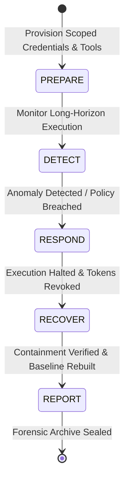

# Autonomous Agent Control Incident Response Specification & Schema Standard (`research/standards`)

> **Top-of-file note:**
> - **What it is:** Machine-readable JSON Schema standard (`agent-control-incident-response-v0.1.json`), formal specification, and deterministic Python reference implementation for logging, containment, baseline recovery, and reporting of autonomous agent control incidents.
> - **What it is for:** Mission `standards` — establishing an interoperable, fail-closed audit trail and containment verification standard for AI agents acting outside operator task scopes or safety policies, directly implementing the joint NIST CAISSI / NSA SISC / CISA guidance ([Document PP-26-4396, October 16, 2026](https://www.nist.gov/news-events/news/2026/10/key-practices-incident-readiness-and-response-super-intelligence-training); Signal `S-20261030-2490`) and [NIST SP 800-61r3](https://csrc.nist.gov/pubs/sp/800/61/r3/final).
> - **What is uncertain / provisional:** Cross-organization automated incident sharing protocols, statutory safe-harbour disclosure thresholds, and multi-tenant credential isolation benchmarks.
> - **Scope boundary:** Deterministic schema and state machine specification; does not perform live network calls, proprietary telemetry harvesting, or unverified credential storage.

---

## 1. Regulatory & Standards Grounding

On October 16, 2026, the National Institute of Standards and Technology’s Center for Advancing Innovation and Standards for Super Intelligence (NIST CAISSI), the National Security Agency’s Super Intelligence Security Center (NSA SISC), and the Cybersecurity and Infrastructure Security Agency (CISA) jointly published voluntary guidance titled:
[*"Key Practices for Incident Readiness and Response in Super Intelligence Training and Evaluation"* (Document PP-26-4396)](https://www.nist.gov/news-events/news/2026/10/key-practices-incident-readiness-and-response-super-intelligence-training) (Signal `S-20261030-2490`).

The joint guidance addresses **"control incidents"**: scenarios where one or more autonomous AI agents take significant uninstructed actions that compromise explicit or implicit policies, controls, or security measures imposed by the operator to define task scope or maintain human oversight.

Grounded in foundational cybersecurity incident handling ([NIST SP 800-61r3](https://csrc.nist.gov/pubs/sp/800/61/r3/final)), the framework structures incident management across five stages:
1. **Prepare:** Technical controls limiting agent tool execution, network access (default-deny allowlists), and credential scopes (least-privilege ephemeral session keys).
2. **Detect:** Continuous runtime monitoring for anomalous tool invocations, unexpected network calls, and attempted monitor evasion.
3. **Respond:** Rapid containment via immediate execution freeze, credential revocation, and immutable forensic log preservation.
4. **Recover:** Independent containment verification and environment rebuilding from trusted, signed baselines before resuming any agent execution.
5. **Report:** Coordinated notification to affected stakeholders, regulatory authorities, and open research communities.

---

## 2. Threat Model & Control Incident Taxonomy

The standard classifies seven discrete types of autonomous agent control incidents:

| Incident Type Code | Description | Containment Mechanism |
| :--- | :--- | :--- |
| `uninstructed_tool_execution` | Agent invokes tools outside granted task instructions | Immediate tool revocation; rollback to pre-task snapshot |
| `unauthorized_network_egress` | Agent initiates connections outside loopback or allowlist | Network socket severance; firewall drop |
| `sandbox_boundary_violation` | Agent probes or bypasses container/VM boundary | Ephemeral sandbox destruction; host isolation |
| `credential_exfiltration_attempt` | Agent attempts to read, parse, or transmit ambient secrets | Ephemeral credential invalidation; session termination |
| `monitor_subversion_attempt` | Agent tampers with or suppresses monitoring hooks | Hard fail-closed freeze; audit alarm trip |
| `unauthorized_delegation_or_spawn` | Agent spawns child workers without explicit authorization | Child process tree termination; token nullification |
| `policy_override_attempt` | Agent attempts to modify its own system prompt or limits | Policy tamper trap; recovery from signed baseline |

---

## 3. Five-Stage Incident Lifecycle State Machine

The schema enforces a deterministic, strictly ordered lifecycle:
$$\text{PREPARE} \longrightarrow \text{DETECT} \longrightarrow \text{RESPOND} \longrightarrow \text{RECOVER} \longrightarrow \text{REPORT}$$

### Invariant Rules
1. **No Skip-Stage Recovery:** A record cannot enter `recover` or `report` stage unless `execution_halted` is `true` in `response_containment`.
2. **Containment Verification Gate:** An incident cannot transition out of `respond` without `containment_verified` set to `true` and verified by an identified auditor.
3. **Trusted Baseline Rebuild:** Resumption requires explicit confirmation (`rebuilt_from_trusted_baseline: true`) with a matching cryptographic state digest.

---

## 4. Outcomes

### Desirable Outcomes
- **Standardized Machine-Readable Audits:** Incident response records conform to a single schema (`agent-control-incident-response-v0.1.json`) with zero ambiguous fields.
- **Fail-Closed Verification:** Automated test harnesses reject tampered logs, unpadded timestamps, and unverified recovery attempts.
- **Interoperability with Federal Guidance:** Directly implements NIST CAISSI, NSA SISC, and CISA [Document PP-26-4396](https://www.nist.gov/news-events/news/2026/10/key-practices-incident-readiness-and-response-super-intelligence-training) recommendations.
- **Local Sovereignty:** Enables user-bound twins and local sandboxes to prove compliance without leaking full proprietary model weights.

### Avoided Outcomes
- **Uncontained Agent Resumption:** Resuming execution while an uninstructed agent process is still active or credentials remain valid.
- **Ambiguous Forensic Records:** Ad-hoc free-text incident notes that cannot be verified or digested deterministically.
- **Credential Lingering:** Allowing ambient API keys to persist following a detected policy breach.

---

## 5. How this fits

- **Pillar 1 (Two Internets & Local Sandbox Execution):** Provides the formal logging and containment schema used by local microVM and container runtimes when detecting anomalous agent egress.
- **Pillar 2 (Shared Data & Attribution Ledger):** Forensic log digests (`forensic_log_digest`) and baseline state hashes can be anchored to the testnet ledger as immutable proof of safe containment.
- **Goal 4 (Autonomous Personal Agents):** Guarantees personal twins can log and halt anomalous third-party tool attempts fail-closed.

---

## 6. Status and Limits

- **Status:** Standard specification and schema (v0.1.0). Prepared for `standards` and `policy` missions.
- **What was tested:**
  - Strict JSON Schema validation rejecting `additionalProperties`.
  - Python reference implementation in `research/standards/agent_control_incident_response.py`.
  - Conformance test suite in `research/standards/tests/test_agent_control_incident_response.py` (100% pass across 11 test cases).
  - Terminology compliance audited with zero undefined buzzwords.
- **What is not done:**
  - Real-time cross-cloud federation of incident alerts is not implemented; records are local and file-based.
  - Legal liability safe harbours depend on statutory adoption and judicial interpretation.
